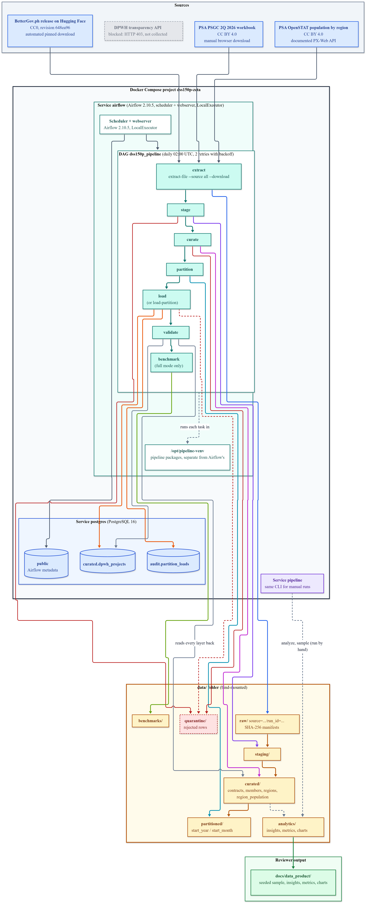
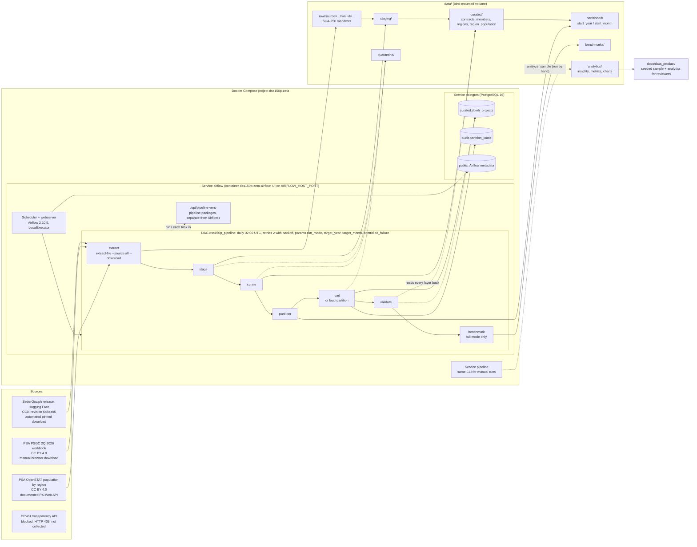

# System Architecture

**Project:** Group Zeta DPWH Infrastructure Pipeline (release v1.0.0)

The deployed system is two Docker Compose files: `docker-compose.yml` runs PostgreSQL and the pipeline image, and `docker-compose.airflow.yml` adds Airflow. Every processing step is one `python -m src.cli` command; Airflow only schedules those commands, retries them and keeps their logs. The diagram below is checked against `dags/dss150p_pipeline.py`, both Compose files and `config/settings.yml`.

## Components

| Component | Where it is defined | Role |
| --- | --- | --- |
| `postgres` | `docker-compose.yml` | PostgreSQL 16. Schemas `curated` and `audit` come from `sql/init/` on first start; Airflow keeps its metadata in `public` of the same database |
| `pipeline` | `docker-compose.yml`, `Dockerfile` | The pipeline image for running any CLI step by hand |
| `airflow` | `docker-compose.airflow.yml`, `Dockerfile.airflow` | Airflow 2.10.5 with the scheduler and webserver in one container (LocalExecutor). The pipeline runs in `/opt/pipeline-venv`, because its pins (SQLAlchemy 2, pandas 3) do not fit Airflow 2's own |
| DAG `dss150p_pipeline` | `dags/dss150p_pipeline.py` | Seven BashOperator tasks, each one CLI command, with `PIPELINE_RUN_ID=airflow__<logical timestamp>` |
| CLI | `src/cli.py` | One entry point for every step: `extract-file`, `stage`, `curate`, `partition`, `load`, `load-partition`, `validate`, `benchmark`, `analyze`, `sample` |
| Validation | `src/validate/pipeline.py` | Raw manifests and expected hashes, each layer's recorded SHA-256 and row counts, reconciliation raw to partitions, recomputed calculations, population coverage, database hashes; exits 1 on any failure |
| Analytics | `src/analytics/full_analysis.py` | Descriptive statistics, per-capita view and an exploratory delay classification; run by hand after a pipeline run, not part of the DAG |

## Data flow

1. `extract` stores each source byte for byte in `data/raw/` after its SHA-256 check: the BetterGov file from its pinned URL, the PSGC workbook from `data/source/`, and the OpenSTAT population and table metadata from its API.
2. `stage` types and normalises the contracts; `curate` adds award metrics, the delay flag, the PSGC region check, the region population table and `record_hash`.
3. `partition` writes Parquet by start year and month; `load` upserts into `curated.dpwh_projects` only where `record_hash` changed, and `load-partition` also writes an audit row.
4. `validate` reads every layer back; `benchmark` compares five storage formats.
5. `analyze` and `sample` produce the reviewer-facing outputs in `data/analytics/` and `docs/data_product/`.

